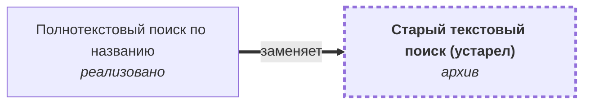

# Старый текстовый поиск (устарел) {#search-old}

## Описание {#article-overview}

Поиск по точному совпадению названия. Заменён полнотекстовым поиском.

<!-- relations:start — раздел формируется скриптом scripts/build_feature_map.py по полю `relations` метаданных, не редактируйте его вручную -->

## Взаимосвязи {#relations}

Схема и таблица показывают прямые связи этой функциональности с другими спецификациями.

| Связь | Функциональность | Статус | Комментарий |
|---|---|---|---|
| Заменена функциональностью | [Полнотекстовый поиск по названию](../../../specifications/catalog/search-text.md#article-overview){data-preview} | :lucide-file-text: реализовано | Поиск по точному совпадению названия выведен из эксплуатации |

<!-- relations:end -->

## Основной сценарий {#main-scenario}

1. Пользователь вводит полное название товара.
2. Система возвращает товары с точным совпадением.

## Критерии приёмки {#acceptance-criteria}

- Заменено фичей ["Полнотекстовый поиск по названию"](../../../specifications/catalog/search-text.md#article-overview){data-preview}.
