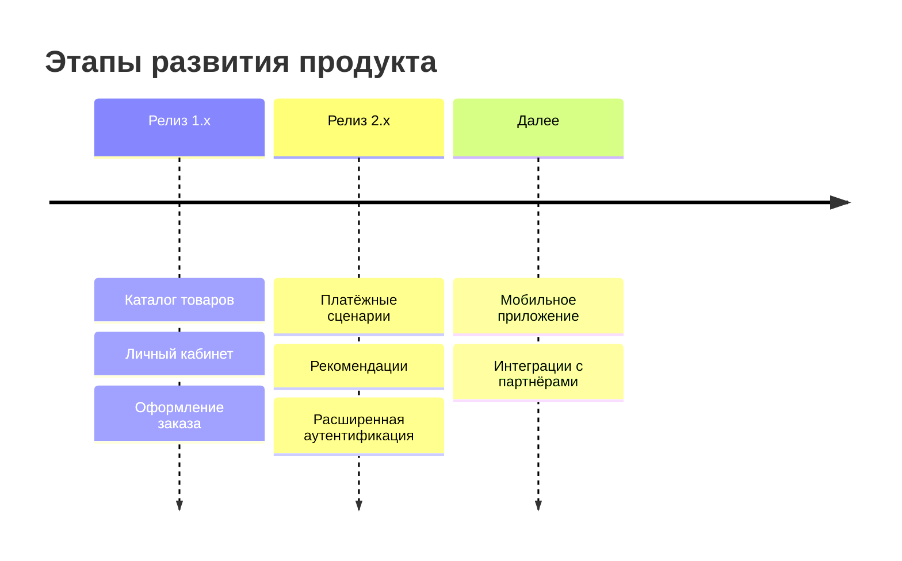

# Roadmap {#roadmap}

## Описание {#article-overview}

Roadmap — это план развития продукта: куда он движется, какие результаты команда хочет получить и в каком порядке.
Страница не заменяет спецификации. Она отвечает на вопрос «зачем и когда», а детали «что именно должна делать функциональность»
описаны в [реестре требований](../registry/overview.md#overview).

Как читать Roadmap:

- **Горизонты планирования.** Ближайший горизонт (текущий и следующий релиз) проработан подробно, дальние — только
  направлениями. Состав дальних горизонтов может меняться.
- **Связь с реестром.** Каждая цель Roadmap раскрывается спецификациями. Их статусы в [обзоре](../registry/overview.md#overview)
  показывают, на каком этапе находится реализация, а вышедшие функциональности перечислены на странице
  [«Релизы»](../releases.md#releases).
- **Обновление.** Roadmap пересматривается по итогам каждого релиза; изменения вносятся в этот файл как обычная правка
  документации (через запрос на слияние).

## Этапы развития {#stages}

| Горизонт           | Цель                                                       | Основные направления                                                    |
|--------------------|------------------------------------------------------------|-------------------------------------------------------------------------|
| Текущий            | Базовый пользовательский путь от поиска до оплаты работает | Каталог товаров, личный кабинет, оформление и оплата заказа             |
| Следующий          | Увеличить конверсию и удобство повторных покупок           | Рекомендации, дополнительные способы оплаты, защита учётной записи      |
| Перспектива        | Расширить каналы и партнёрскую экосистему                  | Мобильное приложение, интеграции с внешними сервисами                   |

## Принципы приоритизации {#priorities}

1. **Ценность для пользователя.** Сначала то, что снимает самые частые затруднения в пользовательском пути.
2. **Зависимости.** Функциональность не планируется раньше тех, от которых она зависит (см. раздел «Взаимосвязи» в
   спецификациях).
3. **Риск и стоимость.** Крупные и неопределённые инициативы разбиваются на этапы, чтобы получать обратную связь
   раньше.
4. **Готовность требований.** В разработку берутся спецификации со статусом «готово к разработке».

## Как изменить Roadmap {#how-to-change}

1. Создайте ветку и отредактируйте `docs/project/roadmap.md`.
2. Если появилась новая цель, заведите спецификации в `docs/registry/active/<модуль>/` по шаблону
   `templates/feature-spec-template.md`.
3. Откройте запрос на слияние: изменения Roadmap обсуждаются так же, как изменения требований.
