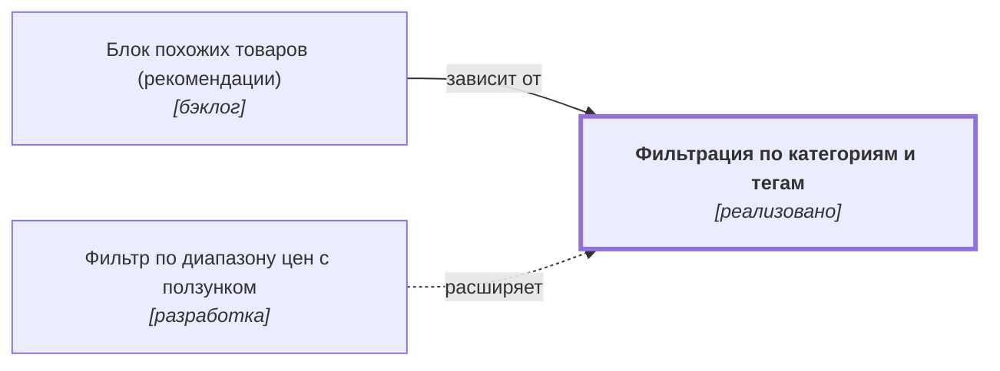

# Фильтрация по категориям и тегам {#filter-categories}

??? note no-icon "<h2 id="change-history" style="display: inline;">Журнал изменений</h2>"

    - [Версия 0.01.03](https://github.com/DmitryKhilko/example-app-requirements/commit/e6dd9ce17ebd521abe7e7bd7ae1a240bd413d20c). Ответственный: Khilko Dmitry
    - [Версия 0.01.02](https://github.com/DmitryKhilko/example-app-requirements/commit/3f24ece8705397b67ef3becf9c0e1fe478b80039). Ответственный: Dmitry Khilko
    - [Версия 0.01.01](https://github.com/DmitryKhilko/example-app-requirements/commit/94ece33ea28b5bbb3b2fe7e5d0edd25aa71cb5a1). Ответственный: Dmitry Khilko
    - [Версия 0.01.00](https://github.com/DmitryKhilko/example-app-requirements/commit/c1507d6b031254b0390488a0796291826d34ec08). Ответственный: Dmitry Khilko
    - [Версия 0.00.20](https://github.com/DmitryKhilko/example-app-requirements/commit/3279bf046d2530e6eed5dde47cf2004f607026b8). Ответственный: Dmitry Khilko
    - [Версия 0.00.19](https://github.com/DmitryKhilko/example-app-requirements/commit/75f3ebdc1c6dca93c1dd99f62bd2e8c61a01e329). Ответственный: Dmitry Khilko
    - [Версия 0.00.18](https://github.com/DmitryKhilko/example-app-requirements/commit/0051b0603735add2d8accbce728da892dbae579d). Ответственный: Dmitry Khilko
    - [Версия 0.00.17](https://github.com/DmitryKhilko/example-app-requirements/commit/7d5df6bfefd1fe59eb97b755a4bdf6d43080dbf8). Ответственный: Dmitry Khilko
    - [Версия 0.00.16](https://github.com/DmitryKhilko/example-app-requirements/commit/87d5d9dc7b4cb601a64eb95f3878882246cb4101). Ответственный: Dmitry Khilko
    - [Версия 0.00.15](https://github.com/DmitryKhilko/example-app-requirements/commit/6bb44418e10d07e49d58a62f2260a3bd5cb55669). Ответственный: Dmitry Khilko
    - [Версия 0.00.14](https://github.com/DmitryKhilko/example-app-requirements/commit/694c2f6fb21f1f454979f1fb76709d1ef0b3a550). Ответственный: Khilko Dmitry
    - [Версия 0.00.13](https://github.com/DmitryKhilko/example-app-requirements/commit/ddc79dfa59baa67a57809a122542dd07e7ab984a). Ответственный: Khilko Dmitry
    - [Версия 0.00.12](https://github.com/DmitryKhilko/example-app-requirements/commit/cfe4d7b95be70c543cd94879cb04881476177cef). Ответственный: Khilko Dmitry
    - [Версия 0.00.11](https://github.com/DmitryKhilko/example-app-requirements/commit/cf30c68a1ee461acc89b2ed7ea500787754ccb20). Ответственный: Dmitry Khilko
    - [Версия 0.00.10](https://github.com/DmitryKhilko/example-app-requirements/commit/1571ad073bf1667c8fcdffca1c40c7133e82d403). Ответственный: Khilko Dmitry
    - [Версия 0.00.09](https://github.com/DmitryKhilko/example-app-requirements/commit/5a2dd672e698a54f6e2dbc118c0b72eea8e05d35). Ответственный: Khilko Dmitry
    - [Версия 0.00.08](https://github.com/DmitryKhilko/example-app-requirements/commit/4bbd4a605df6cae4baa5920512c61dbf350921b6). Ответственный: Khilko Dmitry
    - [Версия 0.00.07](https://github.com/DmitryKhilko/example-app-requirements/commit/663868fc7b7896a5cba00bc32218a76f0332c92a). Ответственный: Dmitry Khilko
    - [Версия 0.00.06](https://github.com/DmitryKhilko/example-app-requirements/commit/5f50ce3550ed662b10aee0b27f23d6a2ff2a30b5). Ответственный: Dmitry Khilko
    - [Версия 0.00.05](https://github.com/DmitryKhilko/example-app-requirements/commit/35f1dbbb63dbe4f347c0bc4e5093d6ada996a519). Ответственный: Dmitry Khilko
    - [Версия 0.00.04](https://github.com/DmitryKhilko/example-app-requirements/commit/3cf1d6105f42d465a0b58d0c9a7e3873168a3169). Ответственный: Dmitry Khilko
    - [Версия 0.00.03](https://github.com/DmitryKhilko/example-app-requirements/commit/182f3c6eb22875ddd8baae40c58596637d79e140). Ответственный: Dmitry Khilko
    - [Версия 0.00.02](https://github.com/DmitryKhilko/example-app-requirements/commit/13a86cc861427e7cfc81cdc1b3eeccd7ba62d2d2). Ответственный: Dmitry Khilko
    - [Версия 0.00.01](https://github.com/DmitryKhilko/example-app-requirements/commit/8e7d7a96059eee2eb5f175a615118d6f9d813dce). Ответственный: Dmitry Khilko

## Описание {#article-overview}

Сужение списка товаров выбором категорий и тегов.

<!-- relations:start — раздел формируется автоматически по полю `relations` метаданных, не редактируйте его вручную -->

## Взаимосвязи {#relations}

Схема и таблица показывают прямые связи этой функциональности с другими спецификациями.

| Связь | Функциональность | Статус | Комментарий |
|---|---|---|---|
| Используется в | [Блок похожих товаров (рекомендации)](product-recommendations.md#article-overview){data-preview} | бэклог | Похожие товары подбираются по категориям и тегам |
| Расширяется функциональностью | [Фильтр по диапазону цен с ползунком](filter-price-slider.md#article-overview){data-preview} | разработка | Добавляет ещё один фильтр в ту же панель фильтров |

<!-- relations:end -->

## Основной сценарий {#main-scenario}

1. Пользователь открывает панель фильтров.
2. Пользователь отмечает одну или несколько категорий и тегов.
3. Система обновляет список без перезагрузки страницы.

## Критерии приёмки {#acceptance-criteria}

- Выбранные фильтры отражаются в адресе страницы.
- Сброс фильтров возвращает полный список.
- При отсутствии результатов отображается сообщение об ошибке и кнопка сброса.

## Критерии релиза {#release-criteria}

- **Наступление даты:** Не ранее 1 декабря 2026 года.
