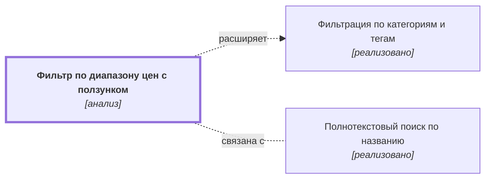

# Фильтр по диапазону цен с ползунком {#filter-price-slider}

??? note no-icon "<h2 id="change-history" style="display: inline;">Журнал изменений</h2>"

    - [Версия 0.01.01](https://github.com/DmitryKhilko/example-app-requirements/commit/5bf3a1fe433f7fe4a0f5a117c9abbf69222d7d1d). Ответственный: Khilko Dmitry
    - [Версия 0.01.00](https://github.com/DmitryKhilko/example-app-requirements/commit/1de627f91060c943c51f314eb554d76ad1e23bd7). Ответственный: Khilko Dmitry
    - [Версия 0.00.18](https://github.com/DmitryKhilko/example-app-requirements/commit/75f3ebdc1c6dca93c1dd99f62bd2e8c61a01e329). Ответственный: Dmitry Khilko
    - [Версия 0.00.17](https://github.com/DmitryKhilko/example-app-requirements/commit/0051b0603735add2d8accbce728da892dbae579d). Ответственный: Dmitry Khilko
    - [Версия 0.00.16](https://github.com/DmitryKhilko/example-app-requirements/commit/7d5df6bfefd1fe59eb97b755a4bdf6d43080dbf8). Ответственный: Dmitry Khilko
    - [Версия 0.00.15](https://github.com/DmitryKhilko/example-app-requirements/commit/87d5d9dc7b4cb601a64eb95f3878882246cb4101). Ответственный: Dmitry Khilko
    - [Версия 0.00.14](https://github.com/DmitryKhilko/example-app-requirements/commit/6bb44418e10d07e49d58a62f2260a3bd5cb55669). Ответственный: Dmitry Khilko
    - [Версия 0.00.13](https://github.com/DmitryKhilko/example-app-requirements/commit/694c2f6fb21f1f454979f1fb76709d1ef0b3a550). Ответственный: Khilko Dmitry
    - [Версия 0.00.12](https://github.com/DmitryKhilko/example-app-requirements/commit/ddc79dfa59baa67a57809a122542dd07e7ab984a). Ответственный: Khilko Dmitry
    - [Версия 0.00.11](https://github.com/DmitryKhilko/example-app-requirements/commit/cfe4d7b95be70c543cd94879cb04881476177cef). Ответственный: Khilko Dmitry
    - [Версия 0.00.10](https://github.com/DmitryKhilko/example-app-requirements/commit/cf30c68a1ee461acc89b2ed7ea500787754ccb20). Ответственный: Dmitry Khilko
    - [Версия 0.00.09](https://github.com/DmitryKhilko/example-app-requirements/commit/1571ad073bf1667c8fcdffca1c40c7133e82d403). Ответственный: Khilko Dmitry
    - [Версия 0.00.08](https://github.com/DmitryKhilko/example-app-requirements/commit/5a2dd672e698a54f6e2dbc118c0b72eea8e05d35). Ответственный: Khilko Dmitry
    - [Версия 0.00.07](https://github.com/DmitryKhilko/example-app-requirements/commit/4bbd4a605df6cae4baa5920512c61dbf350921b6). Ответственный: Khilko Dmitry
    - [Версия 0.00.06](https://github.com/DmitryKhilko/example-app-requirements/commit/663868fc7b7896a5cba00bc32218a76f0332c92a). Ответственный: Dmitry Khilko
    - [Версия 0.00.05](https://github.com/DmitryKhilko/example-app-requirements/commit/5f50ce3550ed662b10aee0b27f23d6a2ff2a30b5). Ответственный: Dmitry Khilko
    - [Версия 0.00.04](https://github.com/DmitryKhilko/example-app-requirements/commit/35f1dbbb63dbe4f347c0bc4e5093d6ada996a519). Ответственный: Dmitry Khilko
    - [Версия 0.00.03](https://github.com/DmitryKhilko/example-app-requirements/commit/3cf1d6105f42d465a0b58d0c9a7e3873168a3169). Ответственный: Dmitry Khilko
    - [Версия 0.00.02](https://github.com/DmitryKhilko/example-app-requirements/commit/13a86cc861427e7cfc81cdc1b3eeccd7ba62d2d2). Ответственный: Dmitry Khilko
    - [Версия 0.00.01](https://github.com/DmitryKhilko/example-app-requirements/commit/8e7d7a96059eee2eb5f175a615118d6f9d813dce). Ответственный: Dmitry Khilko

## Описание {#article-overview}

Ограничение выдачи по минимальной и максимальной цене.

<!-- relations:start — раздел формируется автоматически по полю `relations` метаданных, не редактируйте его вручную -->

## Взаимосвязи {#relations}

Схема и таблица показывают прямые связи этой функциональности с другими спецификациями.

| Связь | Функциональность | Статус | Комментарий |
|---|---|---|---|
| Расширяет | [Фильтрация по категориям и тегам](filter-categories.md#article-overview){data-preview} | реализовано | Добавляет ещё один фильтр в ту же панель фильтров |
| Связана с | [Полнотекстовый поиск по названию](search-text.md#article-overview){data-preview} | реализовано | Границы диапазона цен вычисляются по текущей выдаче, в том числе поисковой |

<!-- relations:end -->

## Основной сценарий {#main-scenario}

1. Пользователь перемещает ползунки или вводит значения вручную.
2. Система пересчитывает список и количество найденных товаров.
3. Система обновляет URL-адрес страницы с новыми параметрами цены.
4. Система обновляет список товаров без перезагрузки страницы.

## Критерии приёмки {#acceptance-criteria}

- Минимальная цена не может превышать максимальную.
- Границы диапазона вычисляются по текущей выдаче.
- Ввод недопустимых символов или отрицательных чисел блокируется.
- Значения в полях ввода автоматически округляются до целых чисел.

## Критерии релиза {#release-criteria}

- **Наступление события:** вступает в действие закон МНС РБ "О налогах" 1 декабря 2026 года.
