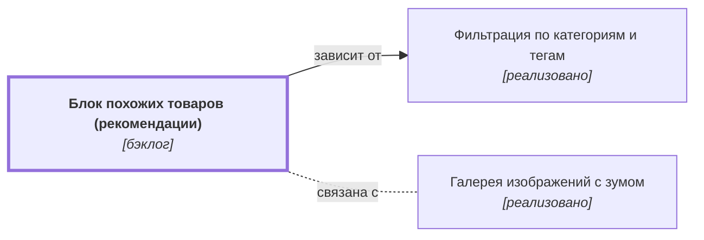

# Блок похожих товаров (рекомендации) {#product-recommendations}

??? note no-icon "<h2 id="change-history" style="display: inline;">Журнал изменений</h2>"

    - [Версия 0.00.17 (01.11.2026 20:01)](https://github.com/DmitryKhilko/example-app-requirements/commit/75f3ebdc1c6dca93c1dd99f62bd2e8c61a01e329){target="_blank" rel="noopener"}. Ответственный: Dmitry Khilko
    - [Версия 0.00.16 (01.11.2026 00:28)](https://github.com/DmitryKhilko/example-app-requirements/commit/0051b0603735add2d8accbce728da892dbae579d){target="_blank" rel="noopener"}. Ответственный: Dmitry Khilko
    - [Версия 0.00.15 (31.10.2026 04:00)](https://github.com/DmitryKhilko/example-app-requirements/commit/7d5df6bfefd1fe59eb97b755a4bdf6d43080dbf8){target="_blank" rel="noopener"}. Ответственный: Dmitry Khilko
    - [Версия 0.00.14 (30.10.2026 22:51)](https://github.com/DmitryKhilko/example-app-requirements/commit/87d5d9dc7b4cb601a64eb95f3878882246cb4101){target="_blank" rel="noopener"}. Ответственный: Dmitry Khilko
    - [Версия 0.00.13 (30.10.2026 21:58)](https://github.com/DmitryKhilko/example-app-requirements/commit/6bb44418e10d07e49d58a62f2260a3bd5cb55669){target="_blank" rel="noopener"}. Ответственный: Dmitry Khilko
    - [Версия 0.00.12 (29.10.2026 18:37)](https://github.com/DmitryKhilko/example-app-requirements/commit/ddc79dfa59baa67a57809a122542dd07e7ab984a){target="_blank" rel="noopener"}. Ответственный: Khilko Dmitry
    - [Версия 0.00.11 (29.10.2026 11:26)](https://github.com/DmitryKhilko/example-app-requirements/commit/cfe4d7b95be70c543cd94879cb04881476177cef){target="_blank" rel="noopener"}. Ответственный: Khilko Dmitry
    - [Версия 0.00.10 (28.10.2026 23:10)](https://github.com/DmitryKhilko/example-app-requirements/commit/cf30c68a1ee461acc89b2ed7ea500787754ccb20){target="_blank" rel="noopener"}. Ответственный: Dmitry Khilko
    - [Версия 0.00.09 (28.10.2026 17:47)](https://github.com/DmitryKhilko/example-app-requirements/commit/1571ad073bf1667c8fcdffca1c40c7133e82d403){target="_blank" rel="noopener"}. Ответственный: Khilko Dmitry
    - [Версия 0.00.08 (28.10.2026 17:42)](https://github.com/DmitryKhilko/example-app-requirements/commit/5a2dd672e698a54f6e2dbc118c0b72eea8e05d35){target="_blank" rel="noopener"}. Ответственный: Khilko Dmitry
    - [Версия 0.00.07 (28.10.2026 14:37)](https://github.com/DmitryKhilko/example-app-requirements/commit/4bbd4a605df6cae4baa5920512c61dbf350921b6){target="_blank" rel="noopener"}. Ответственный: Khilko Dmitry
    - [Версия 0.00.06 (27.10.2026 23:42)](https://github.com/DmitryKhilko/example-app-requirements/commit/663868fc7b7896a5cba00bc32218a76f0332c92a){target="_blank" rel="noopener"}. Ответственный: Dmitry Khilko
    - [Версия 0.00.05 (27.10.2026 22:52)](https://github.com/DmitryKhilko/example-app-requirements/commit/5f50ce3550ed662b10aee0b27f23d6a2ff2a30b5){target="_blank" rel="noopener"}. Ответственный: Dmitry Khilko
    - [Версия 0.00.04 (27.10.2026 22:27)](https://github.com/DmitryKhilko/example-app-requirements/commit/35f1dbbb63dbe4f347c0bc4e5093d6ada996a519){target="_blank" rel="noopener"}. Ответственный: Dmitry Khilko
    - [Версия 0.00.03 (27.10.2026 21:21)](https://github.com/DmitryKhilko/example-app-requirements/commit/3cf1d6105f42d465a0b58d0c9a7e3873168a3169){target="_blank" rel="noopener"}. Ответственный: Dmitry Khilko
    - [Версия 0.00.02 (24.10.2026 23:00)](https://github.com/DmitryKhilko/example-app-requirements/commit/13a86cc861427e7cfc81cdc1b3eeccd7ba62d2d2){target="_blank" rel="noopener"}. Ответственный: Dmitry Khilko
    - [Версия 0.00.01 (24.10.2026 22:01)](https://github.com/DmitryKhilko/example-app-requirements/commit/8e7d7a96059eee2eb5f175a615118d6f9d813dce){target="_blank" rel="noopener"}. Ответственный: Dmitry Khilko

## Описание {#article-overview}

Показ товаров, похожих на просматриваемый.

<!-- relations:start — раздел формируется автоматически по полю `relations` метаданных, не редактируйте его вручную -->

## Взаимосвязи {#relations}

Схема и таблица показывают прямые связи этой функциональности с другими спецификациями.

| Связь | Функциональность | Статус | Комментарий |
|---|---|---|---|
| Зависит от | [Фильтрация по категориям и тегам](filter-categories.md#article-overview){data-preview} | реализовано | Похожие товары подбираются по категориям и тегам |
| Связана с | [Галерея изображений с зумом](product-gallery.md#article-overview){data-preview} | реализовано | Соседние блоки карточки товара |

<!-- relations:end -->

## Основной сценарий {#main-scenario}

1. Пользователь открывает карточку товара.
2. Система подбирает до 8 похожих товаров по категории и тегам.

## Критерии приёмки {#acceptance-criteria}

- Блок не показывается, если подходящих товаров меньше 3.

## Критерии релиза {#release-criteria}

- **Наступление даты:** Не ранее 1 декабря 2026 года.
