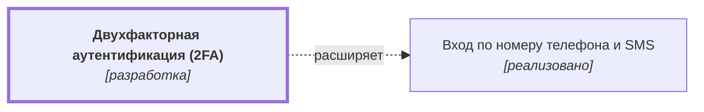

# Двухфакторная аутентификация (2FA) {#auth-2fa}

??? note no-icon "<h2 id="change-history" style="display: inline;">Журнал изменений</h2>"

    Записей пока нет.
  
## Описание {#article-overview}

Дополнительное подтверждение входа одноразовым кодом из приложения-аутентификатора.

<!-- relations:start — раздел формируется автоматически по полю `relations` метаданных, не редактируйте его вручную -->

## Взаимосвязи {#relations}

Схема и таблица показывают прямые связи этой функциональности с другими спецификациями.

| Связь | Функциональность | Статус | Комментарий |
|---|---|---|---|
| Расширяет | [Вход по номеру телефона и SMS](auth-sms.md#article-overview){data-preview} | реализовано | Добавляет второй шаг к входу по номеру телефона |

<!-- relations:end -->

## Основной сценарий {#main-scenario}

1. Пользователь включает 2FA в настройках профиля.
2. Система показывает QR-код и резервные коды.
3. При следующем входе система запрашивает код из приложения.

## Критерии приёмки {#acceptance-criteria}

- Резервные коды показываются один раз.
- Отключение 2FA требует повторного подтверждения.
- Включение 2FA завершается только после успешного ввода проверочного кода из приложения.
- Рядом с QR-кодом отображается текстовый ключ для ручного ввода.
- Каждая резервная копия кода может быть использована для входа только один раз.
- В интерфейсе доступны функции копирования и скачивания резервных кодов.
- При включении или отключении 2FA пользователю отправляется уведомление на email.
- После 5 неверных попыток ввода кода форма 2FA временно блокируется.
- При отключении 2FA сбрасываются все активные сессии на других устройствах.
- В настройках доступна генерация новых резервных кодов, которая аннулирует старые.

## Критерии релиза {#release-criteria}

- **Наступление события:** вступает в действие закон МНС РБ "О налогах" 1 декабря 2026 года.
