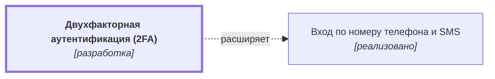

# Двухфакторная аутентификация (2FA) {#auth-2fa}

??? note no-icon "<h2 id="change-history" style="display: inline;">Журнал изменений</h2>"

    - [Версия 0.02.00 (03.11.2026 21:36)](https://github.com/DmitryKhilko/example-app-requirements/commit/cb29952ee1fb5dedec737fc94378330b69df9d26){target="_blank" rel="noopener"}. Ответственный: Dmitry Khilko
    - [Версия 0.01.00 (03.11.2026 21:28)](https://github.com/DmitryKhilko/example-app-requirements/commit/1123b11245ebb89e3c541bd5bd03f61696da748c){target="_blank" rel="noopener"}. Ответственный: Dmitry Khilko
    - [Версия 0.00.27 (03.11.2026 21:26)](https://github.com/DmitryKhilko/example-app-requirements/commit/46a3eaa51509df2a470a3f6de553d581b171b102){target="_blank" rel="noopener"}. Ответственный: Dmitry Khilko
    - [Версия 0.00.26 (03.11.2026 21:17)](https://github.com/DmitryKhilko/example-app-requirements/commit/52a751aaf286e9ad57fa7c3b61908b579ae33b54){target="_blank" rel="noopener"}. Ответственный: Dmitry Khilko
    - [Версия 0.00.25 (03.11.2026 21:14)](https://github.com/DmitryKhilko/example-app-requirements/commit/6bf6ba0896601bc18df54994efe665f6289b6fa2){target="_blank" rel="noopener"}. Ответственный: Dmitry Khilko
    - [Версия 0.00.24 (03.11.2026 03:33)](https://github.com/DmitryKhilko/example-app-requirements/commit/b27df62fd7b6ecb82b09ef621d5d27a5c2a7fd17){target="_blank" rel="noopener"}. Ответственный: Dmitry Khilko
    - [Версия 0.00.23 (03.11.2026 03:21)](https://github.com/DmitryKhilko/example-app-requirements/commit/9fde7b2e03ea304f2f43f96f920b36f70d2e02ad){target="_blank" rel="noopener"}. Ответственный: Dmitry Khilko
    - [Версия 0.00.22 (02.11.2026 17:38)](https://github.com/DmitryKhilko/example-app-requirements/commit/f2ad93f289df7522141854258a5d250ba054dc41){target="_blank" rel="noopener"}. Ответственный: Khilko Dmitry
    - [Версия 0.00.21 (02.11.2026 15:16)](https://github.com/DmitryKhilko/example-app-requirements/commit/389e8fa43f05c8a401fd139e2625d3761f1fcb16){target="_blank" rel="noopener"}. Ответственный: Khilko Dmitry
    - [Версия 0.00.20 (01.11.2026 20:01)](https://github.com/DmitryKhilko/example-app-requirements/commit/75f3ebdc1c6dca93c1dd99f62bd2e8c61a01e329){target="_blank" rel="noopener"}. Ответственный: Dmitry Khilko
    - [Версия 0.00.19 (01.11.2026 00:28)](https://github.com/DmitryKhilko/example-app-requirements/commit/0051b0603735add2d8accbce728da892dbae579d){target="_blank" rel="noopener"}. Ответственный: Dmitry Khilko
    - [Версия 0.00.18 (31.10.2026 04:00)](https://github.com/DmitryKhilko/example-app-requirements/commit/7d5df6bfefd1fe59eb97b755a4bdf6d43080dbf8){target="_blank" rel="noopener"}. Ответственный: Dmitry Khilko
    - [Версия 0.00.17 (31.10.2026 03:28)](https://github.com/DmitryKhilko/example-app-requirements/commit/8aaec585f716102d330946824d2087601a3b1726){target="_blank" rel="noopener"}. Ответственный: Dmitry Khilko
    - [Версия 0.00.16 (31.10.2026 03:25)](https://github.com/DmitryKhilko/example-app-requirements/commit/731fc8cdf01b556d1ad62f912c2ee95fd52735c5){target="_blank" rel="noopener"}. Ответственный: Dmitry Khilko
    - [Версия 0.00.15 (30.10.2026 22:51)](https://github.com/DmitryKhilko/example-app-requirements/commit/87d5d9dc7b4cb601a64eb95f3878882246cb4101){target="_blank" rel="noopener"}. Ответственный: Dmitry Khilko
    - [Версия 0.00.14 (30.10.2026 21:58)](https://github.com/DmitryKhilko/example-app-requirements/commit/6bb44418e10d07e49d58a62f2260a3bd5cb55669){target="_blank" rel="noopener"}. Ответственный: Dmitry Khilko
    - [Версия 0.00.13 (30.10.2026 11:22)](https://github.com/DmitryKhilko/example-app-requirements/commit/694c2f6fb21f1f454979f1fb76709d1ef0b3a550){target="_blank" rel="noopener"}. Ответственный: Khilko Dmitry
    - [Версия 0.00.12 (29.10.2026 18:37)](https://github.com/DmitryKhilko/example-app-requirements/commit/ddc79dfa59baa67a57809a122542dd07e7ab984a){target="_blank" rel="noopener"}. Ответственный: Khilko Dmitry
    - [Версия 0.00.11 (29.10.2026 11:26)](https://github.com/DmitryKhilko/example-app-requirements/commit/cfe4d7b95be70c543cd94879cb04881476177cef){target="_blank" rel="noopener"}. Ответственный: Khilko Dmitry
    - [Версия 0.00.10 (28.10.2026 23:10)](https://github.com/DmitryKhilko/example-app-requirements/commit/cf30c68a1ee461acc89b2ed7ea500787754ccb20){target="_blank" rel="noopener"}. Ответственный: Dmitry Khilko
    - [Версия 0.00.09 (28.10.2026 17:51)](https://github.com/DmitryKhilko/example-app-requirements/commit/246a4da50b1259642c7b29a410f7e3bdf7f83dfc){target="_blank" rel="noopener"}. Ответственный: Khilko Dmitry
    - [Версия 0.00.08 (28.10.2026 17:42)](https://github.com/DmitryKhilko/example-app-requirements/commit/5a2dd672e698a54f6e2dbc118c0b72eea8e05d35){target="_blank" rel="noopener"}. Ответственный: Khilko Dmitry
    - [Версия 0.00.07 (28.10.2026 14:37)](https://github.com/DmitryKhilko/example-app-requirements/commit/4bbd4a605df6cae4baa5920512c61dbf350921b6){target="_blank" rel="noopener"}. Ответственный: Khilko Dmitry
    - [Версия 0.00.06 (27.10.2026 23:42)](https://github.com/DmitryKhilko/example-app-requirements/commit/663868fc7b7896a5cba00bc32218a76f0332c92a){target="_blank" rel="noopener"}. Ответственный: Dmitry Khilko
    - [Версия 0.00.05 (27.10.2026 22:52)](https://github.com/DmitryKhilko/example-app-requirements/commit/5f50ce3550ed662b10aee0b27f23d6a2ff2a30b5){target="_blank" rel="noopener"}. Ответственный: Dmitry Khilko
    - [Версия 0.00.04 (27.10.2026 22:27)](https://github.com/DmitryKhilko/example-app-requirements/commit/35f1dbbb63dbe4f347c0bc4e5093d6ada996a519){target="_blank" rel="noopener"}. Ответственный: Dmitry Khilko
    - [Версия 0.00.03 (27.10.2026 21:21)](https://github.com/DmitryKhilko/example-app-requirements/commit/3cf1d6105f42d465a0b58d0c9a7e3873168a3169){target="_blank" rel="noopener"}. Ответственный: Dmitry Khilko
    - [Версия 0.00.02 (24.10.2026 23:00)](https://github.com/DmitryKhilko/example-app-requirements/commit/13a86cc861427e7cfc81cdc1b3eeccd7ba62d2d2){target="_blank" rel="noopener"}. Ответственный: Dmitry Khilko
    - [Версия 0.00.01 (24.10.2026 22:01)](https://github.com/DmitryKhilko/example-app-requirements/commit/8e7d7a96059eee2eb5f175a615118d6f9d813dce){target="_blank" rel="noopener"}. Ответственный: Dmitry Khilko
  
## Описание {#article-overview}

Дополнительное подтверждение входа одноразовым кодом из приложения-аутентификатора.

<!-- relations:start — раздел формируется автоматически по полю `relations` метаданных, не редактируйте его вручную -->

## Взаимосвязи {#relations}

Схема и таблица показывают прямые связи этой функциональности с другими спецификациями.

| Связь | Функциональность | Статус | Комментарий |
|---|---|---|---|
| Расширяет | [Вход по номеру телефона и SMS](auth-sms.md#article-overview){data-preview} | реализовано | Добавляет второй шаг к входу по номеру телефона |

<!-- relations:end -->

## Основной сценарий {#main-scenario}

1. Пользователь включает 2FA в настройках профиля.
2. Система показывает QR-код и резервные коды.
3. При следующем входе система запрашивает код из приложения.

## Критерии приёмки {#acceptance-criteria}

- Резервные коды показываются один раз.
- Отключение 2FA требует повторного подтверждения.
- Включение 2FA завершается только после успешного ввода проверочного кода из приложения.
- Рядом с QR-кодом отображается текстовый ключ для ручного ввода.
- Каждая резервная копия кода может быть использована для входа только один раз.
- В интерфейсе доступны функции копирования и скачивания резервных кодов.
- При включении или отключении 2FA пользователю отправляется уведомление на email.
- После 5 неверных попыток ввода кода форма 2FA временно блокируется.
- При отключении 2FA сбрасываются все активные сессии на других устройствах.
- В настройках доступна генерация новых резервных кодов, которая аннулирует старые.

## Критерии релиза {#release-criteria}

- **Наступление события:** вступает в действие закон МНС РБ "О налогах" 1 декабря 2026 года.
