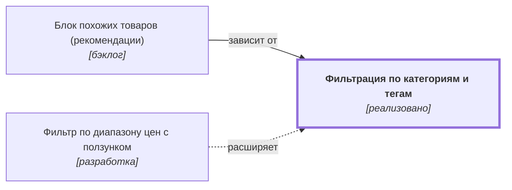

# Фильтрация по категориям и тегам {#filter-categories}

## Описание {#article-overview}

Сужение списка товаров выбором категорий и тегов.

<!-- relations:start — раздел формируется автоматически по полю `relations` метаданных, не редактируйте его вручную -->

## Взаимосвязи {#relations}

Схема и таблица показывают прямые связи этой функциональности с другими спецификациями.

| Связь | Функциональность | Статус | Комментарий |
|---|---|---|---|
| Используется в | [Блок похожих товаров (рекомендации)](product-recommendations.md#article-overview){data-preview} | бэклог | Похожие товары подбираются по категориям и тегам |
| Расширяется функциональностью | [Фильтр по диапазону цен с ползунком](filter-price-slider.md#article-overview){data-preview} | разработка | Добавляет ещё один фильтр в ту же панель фильтров |

<!-- relations:end -->

## Основной сценарий {#main-scenario}

1. Пользователь открывает панель фильтров.
2. Пользователь отмечает одну или несколько категорий и тегов.
3. Система обновляет список без перезагрузки страницы.

## Критерии приёмки {#acceptance-criteria}

- Выбранные фильтры отражаются в адресе страницы.
- Сброс фильтров возвращает полный список.
