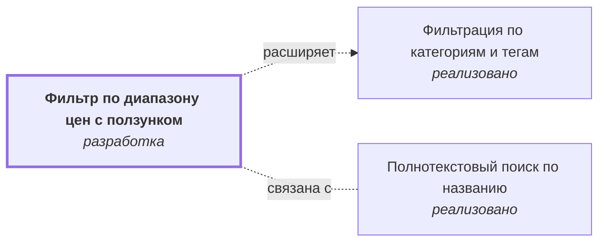

# Фильтр по диапазону цен с ползунком {#filter-price-slider}

## Описание {#article-overview}

Ограничение выдачи по минимальной и максимальной цене.

<!-- relations:start — раздел формируется скриптом scripts/build_feature_map.py по полю `relations` метаданных, не редактируйте его вручную -->

## Взаимосвязи {#relations}

Схема и таблица показывают прямые связи этой функциональности с другими спецификациями.

| Связь | Функциональность | Статус | Комментарий |
|---|---|---|---|
| Расширяет | [Фильтрация по категориям и тегам](filter-categories.md#article-overview){data-preview} | :lucide-file-text: реализовано | Добавляет ещё один фильтр в ту же панель фильтров |
| Связана с | [Полнотекстовый поиск по названию](search-text.md#article-overview){data-preview} | :lucide-file-text: реализовано | Границы диапазона цен вычисляются по текущей выдаче, в том числе поисковой |

<!-- relations:end -->

## Основной сценарий {#main-scenario}

1. Пользователь перемещает ползунки или вводит значения вручную.
2. Система пересчитывает список и количество найденных товаров.

## Критерии приёмки {#acceptance-criteria}

- Минимальная цена не может превышать максимальную.
- Границы диапазона вычисляются по текущей выдаче.
