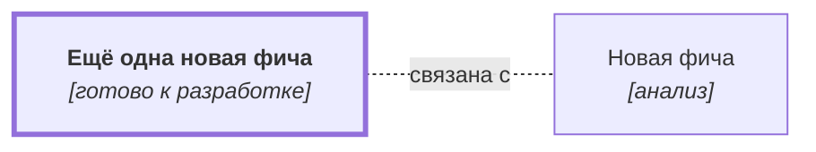

# Ещё одна новая фича {#new-feature-copy}

## Описание {#article-overview}

Пользователь ...

<!-- relations:start — раздел формируется скриптом scripts/build_feature_map.py по полю `relations` метаданных, не редактируйте его вручную -->

## Взаимосвязи {#relations}

Схема и таблица показывают прямые связи этой функциональности с другими спецификациями.

| Связь | Функциональность | Статус | Комментарий |
|---|---|---|---|
| Связана с | [Новая фича](new-feature.md#article-overview){data-preview} | анализ | Копия-шаблон фичи |

<!-- relations:end -->

## Основной сценарий {#main-scenario}

1. ...
2. ...
3. ...

## Критерии приёмки {#acceptance-criteria}

- ...
- ...
