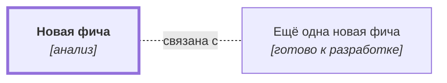

# Новая фича {#new-feature}

## Описание {#article-overview}

Пользователь ...

<!-- relations:start — раздел формируется автоматически по полю `relations` метаданных, не редактируйте его вручную -->

## Взаимосвязи {#relations}

Схема и таблица показывают прямые связи этой функциональности с другими спецификациями.

| Связь | Функциональность | Статус | Комментарий |
|---|---|---|---|
| Связана с | [Ещё одна новая фича](new-feature-copy.md#article-overview){data-preview} | готово к разработке | Копия-шаблон фичи |

<!-- relations:end -->

## Основной сценарий {#main-scenario}

1. ...
2. ...
3. ...

## Критерии приёмки {#acceptance-criteria}

- ...
- ...

## Критерии релиза {#release-criteria}

- **Наступление даты:** Не ранее 1 декабря 2026 года.

## Ссылка на задачу {#task}

[Задача 01](https://github.bmf/khilko/app_requirements/issues/1){:target="_blank"}
