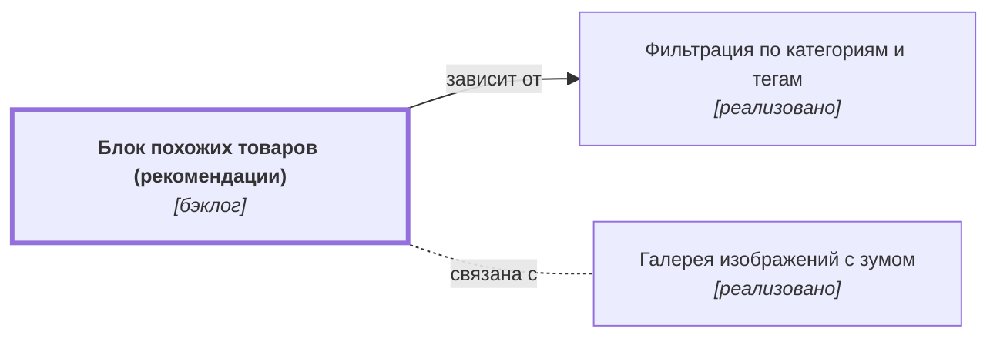

# Блок похожих товаров (рекомендации) {#product-recommendations}

## Описание {#article-overview}

Показ товаров, похожих на просматриваемый.

<!-- relations:start — раздел формируется автоматически по полю `relations` метаданных, не редактируйте его вручную -->

## Взаимосвязи {#relations}

Схема и таблица показывают прямые связи этой функциональности с другими спецификациями.

| Связь | Функциональность | Статус | Комментарий |
|---|---|---|---|
| Зависит от | [Фильтрация по категориям и тегам](filter-categories.md#article-overview){data-preview} | реализовано | Похожие товары подбираются по категориям и тегам |
| Связана с | [Галерея изображений с зумом](product-gallery.md#article-overview){data-preview} | реализовано | Соседние блоки карточки товара |

<!-- relations:end -->

## Основной сценарий {#main-scenario}

1. Пользователь открывает карточку товара.
2. Система подбирает до 8 похожих товаров по категории и тегам.

## Критерии приёмки {#acceptance-criteria}

- Блок не показывается, если подходящих товаров меньше 3.

## Критерии релиза {#release-criteria}

- **Наступление даты:** Не ранее 1 декабря 2026 года.

## Ссылка на задачу {#task}

[Задача 01](https://github.bmf/khilko/app_requirements/issues/1){:target="_blank"}
