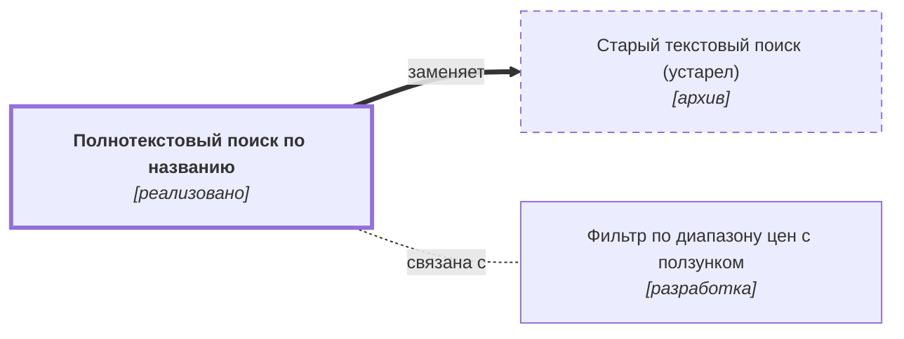

# Полнотекстовый поиск по названию {#search-text}

## Описание {#article-overview}

Пользователь находит товары, вводя часть названия в строку поиска.

<!-- relations:start — раздел формируется автоматически по полю `relations` метаданных, не редактируйте его вручную -->

## Взаимосвязи {#relations}

Схема и таблица показывают прямые связи этой функциональности с другими спецификациями.

| Связь | Функциональность | Статус | Комментарий |
|---|---|---|---|
| Заменяет | [Старый текстовый поиск (устарел)](../../archive/specifications/catalog/search-old.md#article-overview){data-preview} | архив | Поиск по точному совпадению названия выведен из эксплуатации |
| Связана с | [Фильтр по диапазону цен с ползунком](filter-price-slider.md#article-overview){data-preview} | разработка | Границы диапазона цен вычисляются по текущей выдаче, в том числе поисковой |

<!-- relations:end -->

## Основной сценарий {#main-scenario}

1. Пользователь вводит не менее 3 символов в строку поиска.
2. Система показывает подсказки не позднее чем через 300 мс.
3. Пользователь выбирает подсказку или нажимает Enter, система открывает список результатов.

## Критерии приёмки {#acceptance-criteria}

- Поиск не зависит от регистра и учитывает опечатки в один символ.
- При отсутствии результатов показывается сообщение и рекомендации.
