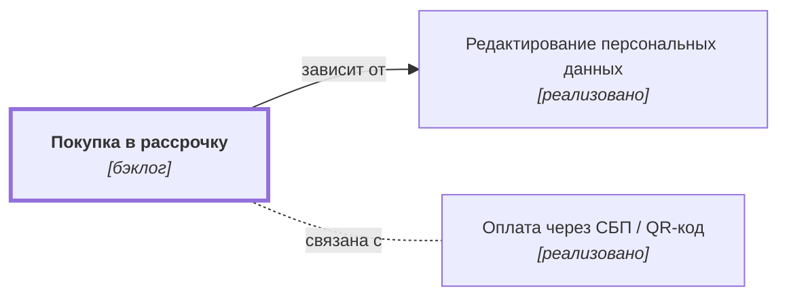

# Покупка в рассрочку {#credit-pay}

## Описание {#article-overview}

Оплата заказа частями через банк-партнёр.

<!-- relations:start — раздел формируется автоматически по полю `relations` метаданных, не редактируйте его вручную -->

## Взаимосвязи {#relations}

Схема и таблица показывают прямые связи этой функциональности с другими спецификациями.

| Связь | Функциональность | Статус | Комментарий |
|---|---|---|---|
| Зависит от | [Редактирование персональных данных](../profile/edit-data.md#article-overview){data-preview} | реализовано | Персональные данные клиента передаются в заявке банку-партнёру |
| Связана с | [Оплата через СБП / QR-код](payment-sbp.md#article-overview){data-preview} | реализовано | Альтернативный способ оплаты при оформлении заказа |

<!-- relations:end -->

## Основной сценарий {#main-scenario}

1. Клиент выбирает «Рассрочка» и срок.
2. Система передаёт заявку партнёру и показывает решение.

## Критерии приёмки {#acceptance-criteria}

- Доступно для заказов от 10 000 ₽.
