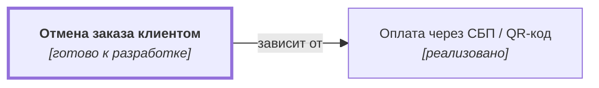

# Отмена заказа клиентом {#order-cancel}

## Описание {#article-overview}

Клиент самостоятельно отменяет заказ, пока он не передан в доставку.

<!-- relations:start — раздел формируется автоматически по полю `relations` метаданных, не редактируйте его вручную -->

## Взаимосвязи {#relations}

Схема и таблица показывают прямые связи этой функциональности с другими спецификациями.

| Связь | Функциональность | Статус | Комментарий |
|---|---|---|---|
| Зависит от | [Оплата через СБП / QR-код](payment-sbp.md#article-overview){data-preview} | реализовано | Возврат средств при отмене выполняется тем же способом, которым оплачен заказ |

<!-- relations:end -->

## Основной сценарий {#main-scenario}

1. Клиент открывает заказ в истории.
2. Клиент нажимает «Отменить» и указывает причину.
3. Система меняет статус заказа и инициирует возврат средств.

## Критерии приёмки {#acceptance-criteria}

- Отмена недоступна для заказов в статусах «Передан в доставку» и «Доставлен».
- Возврат инициируется не позднее 1 часа после отмены.

## Критерии релиза {#release-criteria}

- **Наступление даты:** Не ранее 1 декабря 2026 года.
