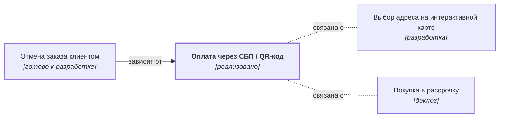

# Оплата через СБП / QR-код {#payment-sbp}

## Описание {#article-overview}

Оплата заказа через Систему быстрых платежей.

<!-- relations:start — раздел формируется автоматически по полю `relations` метаданных, не редактируйте его вручную -->

## Взаимосвязи {#relations}

Схема и таблица показывают прямые связи этой функциональности с другими спецификациями.

| Связь | Функциональность | Статус | Комментарий |
|---|---|---|---|
| Используется в | [Отмена заказа клиентом](order-cancel.md#article-overview){data-preview} | готово к разработке | Возврат средств при отмене выполняется тем же способом, которым оплачен заказ |
| Связана с | [Выбор адреса на интерактивной карте](checkout-map.md#article-overview){data-preview} | разработка | Соседние шаги оформления заказа: доставка и оплата |
| Связана с | [Покупка в рассрочку](credit-pay.md#article-overview){data-preview} | бэклог | Альтернативный способ оплаты при оформлении заказа |

<!-- relations:end -->

## Основной сценарий {#main-scenario}

1. Клиент выбирает способ оплаты «СБП».
2. Система показывает QR-код и ссылку для мобильного приложения банка.
3. Система получает подтверждение платежа и завершает оформление.

## Критерии приёмки {#acceptance-criteria}

- Срок действия QR-кода — 10 минут.
- Статус оплаты обновляется без перезагрузки страницы.
