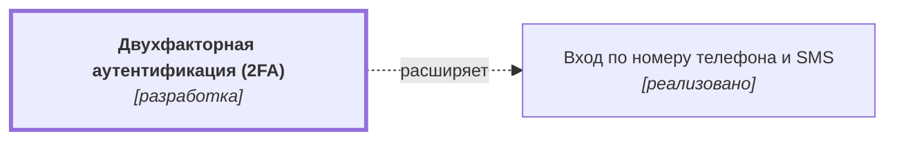

# Двухфакторная аутентификация (2FA) {#auth-2fa}

## Описание {#article-overview}

Дополнительное подтверждение входа одноразовым кодом из приложения-аутентификатора.

<!-- relations:start — раздел формируется автоматически по полю `relations` метаданных, не редактируйте его вручную -->

## Взаимосвязи {#relations}

Схема и таблица показывают прямые связи этой функциональности с другими спецификациями.

| Связь | Функциональность | Статус | Комментарий |
|---|---|---|---|
| Расширяет | [Вход по номеру телефона и SMS](auth-sms.md#article-overview){data-preview} | реализовано | Добавляет второй шаг к входу по номеру телефона |

<!-- relations:end -->

## Основной сценарий {#main-scenario}

1. Пользователь включает 2FA в настройках профиля.
2. Система показывает QR-код и резервные коды.
3. При следующем входе система запрашивает код из приложения.

## Критерии приёмки {#acceptance-criteria}

- Резервные коды показываются один раз.
- Отключение 2FA требует повторного подтверждения.

## Критерии релиза {#release-criteria}

- **Наступление даты:** Не ранее 1 декабря 2026 года.

## Ссылка на задачу {#task}

[Задача 01](https://github.bmf/khilko/app_requirements/issues/1){:target="_blank"}
