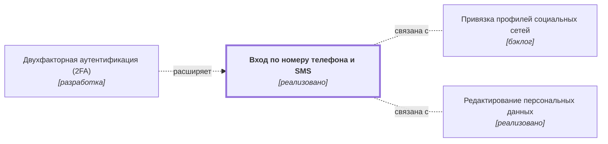

# Вход по номеру телефона и SMS {#auth-sms}

## Описание {#article-overview}

Вход без пароля по одноразовому коду из SMS.

<!-- relations:start — раздел формируется автоматически по полю `relations` метаданных, не редактируйте его вручную -->

## Взаимосвязи {#relations}

Схема и таблица показывают прямые связи этой функциональности с другими спецификациями.

| Связь | Функциональность | Статус | Комментарий |
|---|---|---|---|
| Расширяется функциональностью | [Двухфакторная аутентификация (2FA)](auth-2fa.md#article-overview){data-preview} | разработка | Добавляет второй шаг к входу по номеру телефона |
| Связана с | [Привязка профилей социальных сетей](oauth.md#article-overview){data-preview} | бэклог | Альтернативный способ входа |
| Связана с | [Редактирование персональных данных](edit-data.md#article-overview){data-preview} | реализовано | Смена номера телефона влияет на вход по SMS |

<!-- relations:end -->

## Основной сценарий {#main-scenario}

1. Пользователь вводит номер телефона.
2. Система отправляет SMS с шестизначным кодом.
3. Пользователь вводит код, система создаёт сессию.

## Критерии приёмки {#acceptance-criteria}

- Код действует 5 минут.
- После 3 неверных попыток ввод блокируется на 15 минут.

## Критерии релиза {#release-criteria}

- **Наступление даты:** Не ранее 1 декабря 2026 года.

## Ссылка на задачу {#task}

[Задача 01](https://github.bmf/khilko/app_requirements/issues/1){:target="_blank"}
