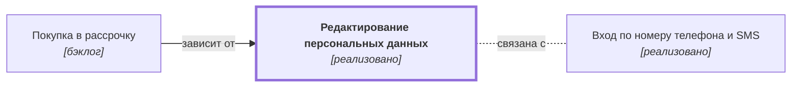

# Редактирование персональных данных {#edit-data}

## Описание {#article-overview}

Изменение имени, e-mail и контактных данных пользователя.

<!-- relations:start — раздел формируется автоматически по полю `relations` метаданных, не редактируйте его вручную -->

## Взаимосвязи {#relations}

Схема и таблица показывают прямые связи этой функциональности с другими спецификациями.

| Связь | Функциональность | Статус | Комментарий |
|---|---|---|---|
| Используется в | [Покупка в рассрочку](../orders/credit-pay.md#article-overview){data-preview} | бэклог | Персональные данные клиента передаются в заявке банку-партнёру |
| Связана с | [Вход по номеру телефона и SMS](auth-sms.md#article-overview){data-preview} | реализовано | Смена номера телефона влияет на вход по SMS |

<!-- relations:end -->

## Основной сценарий {#main-scenario}

1. Пользователь открывает раздел «Профиль».
2. Пользователь изменяет поля и сохраняет форму.

## Критерии приёмки {#acceptance-criteria}

- Смена e-mail требует подтверждения по ссылке из письма.

## Ссылка на задачу {#task}

[Задача 01](https://github.bmf/khilko/app_requirements/issues/1)
