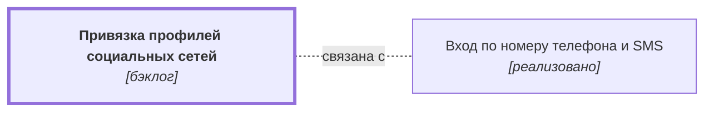

# Привязка профилей социальных сетей {#oauth}

## Описание {#article-overview}

Привязка внешних аккаунтов для быстрого входа.

<!-- relations:start — раздел формируется автоматически по полю `relations` метаданных, не редактируйте его вручную -->

## Взаимосвязи {#relations}

Схема и таблица показывают прямые связи этой функциональности с другими спецификациями.

| Связь | Функциональность | Статус | Комментарий |
|---|---|---|---|
| Связана с | [Вход по номеру телефона и SMS](auth-sms.md#article-overview){data-preview} | реализовано | Альтернативный способ входа |

<!-- relations:end -->

## Основной сценарий {#main-scenario}

1. Пользователь выбирает социальную сеть в настройках профиля.
2. Система выполняет авторизацию у провайдера и привязывает аккаунт.

## Критерии приёмки {#acceptance-criteria}

- К одному профилю можно привязать не более одного аккаунта каждой сети.

## Критерии релиза {#release-criteria}

- **Наступление даты:** Не ранее 1 декабря 2026 года.

## Ссылка на задачу {#task}

[Задача 01](https://github.bmf/khilko/app_requirements/issues/1){:target="_blank"}
